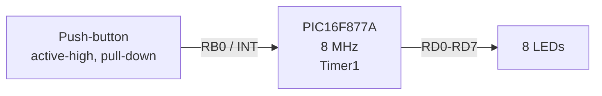
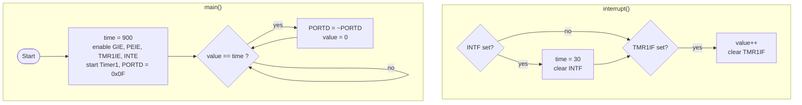

# Microcontroller-Interrupts-Timers

Using **interrupts** on the PIC16F877A: the external interrupt on **RB0/INT** and the **Timer1 overflow** interrupt. Together they build accurate timing without `delay_ms` blocking the main loop.

## Target hardware & settings

| Setting | Value |
|---|---|
| Microcontroller | **PIC16F877A** |
| Clock | 8 MHz crystal (HS), so 1 instruction cycle = 4 / 8 MHz = **0.5 µs** |
| Compiler / IDE | mikroC PRO for PIC (`void interrupt()` is the ISR at vector 0x0004) |
| Config word | `0x2F4A`: HS oscillator, WDT off, PWRT off, BOR on, LVP off, no code protection |

## Registers used

| Register bit | Meaning |
|---|---|
| `INTCON.F7` GIE | Global interrupt enable |
| `INTCON.F6` PEIE | Peripheral interrupt enable (needed for Timer1) |
| `INTCON.F4` INTE | Enable external interrupt on RB0/INT |
| `INTCON.F1` INTF | External interrupt flag (must be cleared in the ISR) |
| `OPTION_REG.F6` INTEDG | 1 = trigger on **rising** edge |
| `T1CON.F0` TMR1ON | Start Timer1 (prescaler 1:1, internal clock) |
| `PIE1.F0` TMR1IE | Enable Timer1 overflow interrupt |
| `PIR1.F0` TMR1IF | Timer1 overflow flag (must be cleared in the ISR) |

## Timing math

Timer1 is 16-bit, so it overflows every 65 536 cycles × 0.5 µs = **32.768 ms**.

| Overflows counted | Time |
|---|---|
| 30 | 30 × 32.768 ms ≈ **0.98 s** (about 1 second) |
| 900 | ≈ **29.5 s** |
| 1800 | ≈ **59 s** (about 1 minute) |

> The comments in the code use 32 768 per overflow, but Timer1 counts the full 65 536. The values above are the real timings at 8 MHz.

## Wiring

## Sub-projects

### `INTERRUPT 1/`: external interrupt resets a counter
- The main loop shows a binary counter on PORTD (`PORTD = value++`) every 1 s.
- A rising edge on **RB0/INT** runs the ISR, which sets `value = 0` and clears INTF.
- **Result:** the LEDs count up in binary, and pressing the button restarts the count from 0.

### `INTERRUPT 2/`: Timer1 makes a 1-second blinker
- The Timer1 ISR increments `value` on every overflow.
- The main loop: when `value == 30` (≈1 s), it inverts PORTD and resets `value`.
- PORTD starts at `0x0F`, so the low and high nibbles swap every second.

### `INTERRUPT 3/`: Timer1 makes a 1-minute toggle
- Same as above but with `value == 1800`, so PORTD toggles about once a minute.

### `INTERRUPT 4/`: both interrupts together
- Starts with `time = 900`, so PORTD toggles every ≈29.5 s.
- The ISR checks **which** flag fired:
  - **INTF** (button): sets `time = 30`, so it switches to fast ≈1 s toggling.
  - **TMR1IF**: `value++`.
- Main loop: `if (value == time)`, it toggles PORTD and resets `value`.

### Note
In `INTERRUPT 4`, if the button is pressed when `value` is already above 30, `value == time` won't be true until `value` wraps around at 65 536 (about 36 minutes). Using `if (value >= time)` avoids this.

## Build & flash
Open the `.mcppi` file of a sub-project in mikroC PRO for PIC, build, and flash the `.hex`.
